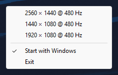

# trayres

A tiny Windows tray app that switches your primary display between a few resolutions. One 11 KB exe in plain C,
with no CRT, installer, service, updater, network access or telemetry. It sits in the notification area and does
nothing until you click it.



Click the icon (left or right) to get a menu with your modes. Click one and the primary display switches to it.
The check mark shows the current mode. The menu also has **Start with Windows** and **Exit**.

## Install

1. Download `trayres.exe` from [Releases](https://github.com/l0rem/trayres/releases) and put it in a folder you
   can write to, e.g. `%LOCALAPPDATA%\Programs\trayres`. The exe isn't code-signed, so SmartScreen may warn the
   first time (More info → Run anyway).
2. Run it once. It writes `trayres.ini` next to itself and adds itself to startup
   (`HKCU\Software\Microsoft\Windows\CurrentVersion\Run`, value `trayres`).

Windows 11 puts new tray icons in the overflow (^) menu. To keep it on the taskbar, drag it out or turn it on
under Settings → Personalization → Taskbar → Other system tray icons.

## Config

`trayres.ini` next to the exe, one mode per line:

```ini
[modes]
2560x1440@480
1440x1080@480
1920x1080@480
```

- If the monitor doesn't list the given refresh rate for that size, trayres uses the highest one it lists.
  Leave out `@480` to always take the highest.
- Lines starting with `;`, `#` or `[` are ignored. Up to 16 modes.
- Changes apply the next time you open the menu, with no restart needed. Sizes the monitor doesn't offer show up greyed out.

trayres only changes width, height and refresh rate (32-bit colour) and saves the mode, the same as Windows
Settings does. Scaling is left to the GPU driver. For stretched 4:3, set NVIDIA Control Panel → Adjust desktop
size and position → **Full-screen** once; it then applies to every non-native mode trayres picks.

## Uninstall

Open the menu, untick **Start with Windows**, click **Exit**, then delete the folder.

## Resource use

Its one thread sits blocked in `GetMessage` (Windows adds 3 idle worker threads of its own). There are no timers
or polling, and the working set is trimmed after the menu closes. Measured with `Get-Process` on Windows 11 25H2 (Ryzen 7 9800X3D) over 10 minutes idle:

| | |
|---|---|
| CPU time used while idle | 0 ms (15.6 ms total, all at startup) |
| Private bytes | 1.5 MB |
| Working set | 0.3–0.8 MB |
| Handles | 132 (mostly shell32's, loaded for the tray icon) |

## Build

Needs [zig](https://ziglang.org) 0.17.1 (it cross-compiles from macOS or Linux, or builds on Windows):

```sh
./build.sh        # → trayres.exe
```

The build is deterministic: the same zig version gives the same bytes. Tagged releases are built by
[the workflow](.github/workflows/build.yml), which also publishes the SHA-256 so you can compare it with your own
build. `res/icon.py` redraws the icon (`uv run --with pillow python res/icon.py res/trayres.ico`), and
`test/` has the PowerShell scripts used to verify it on a real machine.

## License

MIT
